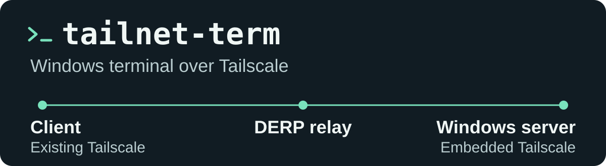

# tailnet-term



Open an interactive Windows shell over Tailscale, or run a single PowerShell command and get its output and exit code. The client uses an existing Tailscale installation. The server embeds its own Tailnet connection.

[Connect](#connect) · [Run a single command](#run-a-single-command) · [Build](#build) · [Windows Server 2016](#interactive-sessions-on-windows-server-2016)

## Connect

Build the [Windows x64 executables](#build) and place an executable on each machine. Use the legacy-support build on [Windows Server 2016](#interactive-sessions-on-windows-server-2016). Use matching client and server versions. Mixed versions fail with a compatibility error.

1. On the client, run `.\tailnet-term.exe keygen .\client.key`. Keep the private key on the client and copy the printed public key to the server. Run `.\tailnet-term.exe ip` to print the client's Tailnet IPv4 address for the server command below.
2. On the server, set the `TS_AUTH_KEY` environment variable to a valid Tailscale auth key for initial enrollment. Start the server:

   ```powershell
   .\tailnet-term.exe server <client-tailnet-ip> <client-public-key> 'C:\Path\To\pwsh.exe' .\server.state
   ```

3. On the client, use the Tailnet IP printed by the server:

   ```powershell
   .\tailnet-term.exe client <server-tailnet-ip> .\client.key
   ```

Use `exit` to close the session. Reuse the state file when restarting the server. Each connection starts a fresh shell session, and one client can connect at a time.

## Run a single command

Add a command after the key file to run it without a terminal, as with `ssh host command`:

```powershell
.\tailnet-term.exe client <server-tailnet-ip> .\client.key hostname
.\tailnet-term.exe client <server-tailnet-ip> .\client.key 'Get-ChildItem C:\ | Select-Object Name'
```

The command and its arguments are joined with spaces and run by the server's PowerShell. Quote the whole remote command so the local shell keeps its quotes, pipes and semicolons. The command gets no standard input. Its stdout and stderr arrive separately as UTF-8, without terminal escape sequences or line wrapping. The client exits with the command's exit code: an explicit `exit N`, otherwise the native exit code of a failed last command (or 1), and 0 on success. When the connection fails or ends early, the client exits with 255. Closing the client stops the command.

Use single-command mode for scripts and agents.

## Build

Run `.\Build-TailnetTerm.ps1` to build two Windows x64 executables compressed with UPX in `target\release`.

| Interactive terminal | Executable |
| --- | --- |
| ConPTY | `tailnet-term.exe` |
| ConPTY with a classic Windows console fallback | `tailnet-term-legacy-support.exe` |

The script installs missing Rust and MSVC build tools when run online and downloads and verifies UPX. MSVC setup may request administrator approval. Use `-Offline` with cached tools and dependencies, or `-Upx <path>` to use a specific UPX executable. Both packed executables must stay under 1 MB.

### Interactive sessions on Windows Server 2016

Deploy `tailnet-term-legacy-support.exe` to the server. When ConPTY is unavailable,
the server starts a hidden classic Windows console in a helper process from the
same executable. The client uses the same command and protocol.

Pass the absolute path to `cmd.exe`, `pwsh.exe` or `powershell.exe` as the server's
shell and connect in interactive mode. The classic backend reads a finite console
screen buffer and does not implement mouse input or full alternate-screen
semantics. The single-command mode still requires PowerShell.

Set `TAILNET_TERM_FORCE_CLASSIC_PTY=1` on a newer Windows server running the
`legacy-support` build to test the classic backend.

## Relay and reconnection

The server selects a DERP relay automatically. Set `TS_DERP_REGION` to a numeric region ID to override the selection.

The server keeps running when the client restarts or re-logs in to Tailscale, and it reconnects to Tailscale control and the DERP relay after network failures, retrying with a delay of up to 30 seconds. If the client disappears without closing its connection, the server drops the session after about a minute and accepts a new connection.

## Diagnostics

Developer probe commands are not part of the regular build. Build them with `cargo build --features diagnostics`:

- `control` checks the connection to Tailscale control (HTTPS key lookup, Noise handshake, HTTP/2).
- `relay <DERP-HOST>` checks the TLS connection and handshake with a DERP relay.
- `pty-check <SHELL>` runs a shell with the selected console backend and checks interactive input, output and process handling.

See [repository conventions and engineering priorities](AGENTS.md).
